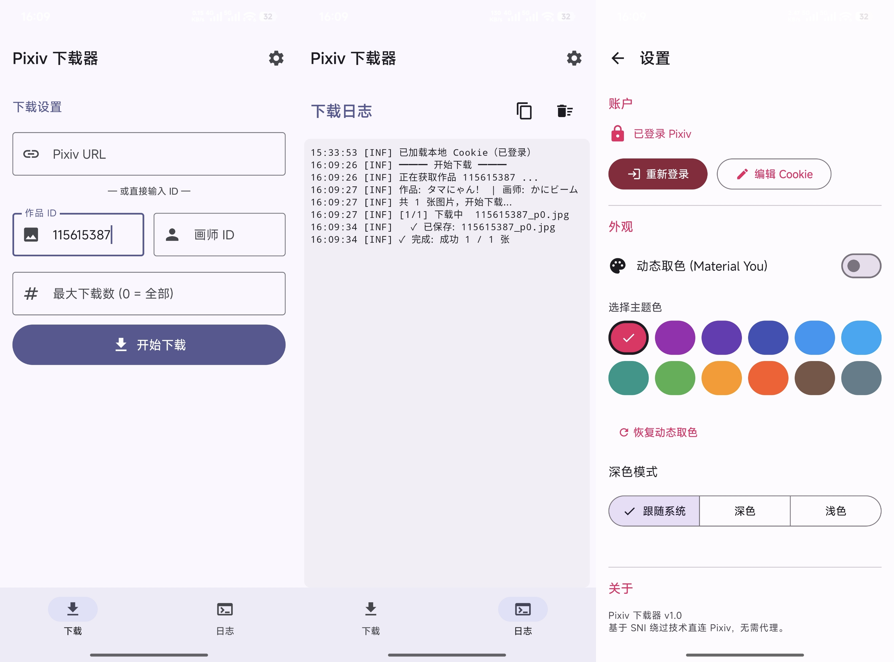

# Pixiv 下载器 (Android)

[English](README.md) | 中文

通过 ECH（加密客户端 Hello）直连 Pixiv 的 Android 图片下载器。免代理、免 VPN。



## 功能

- **ECH 直连** — 元数据 API（`www.pixiv.net`）走 ECH（RFC 9580）加密握手：真实域名整体加密在 TLS 握手内层，审查看不到、Cloudflare 的无 SNI 拒绝也拦不住。ECH 不可用时自动回退旧直连路径
- **无 SNI 图片下载** — `i.pximg.net` 仍用裸 `SSLSocket` 无 SNI 直连，靠 `Host` 头路由
- **双标签页** — 下载设置 / 实时日志
- **WebView 登录** — 应用内登录并自动保存 Cookie；Cookie 失效（HTTP 401）时自动降级为匿名请求
- **原图反推** — 当原图链接被抹除时，从缩略图时间戳重建原图 URL + 格式盲测
- **批量下载** — 支持画师全部作品下载，可限制数量
- **归档保存** — 自动按 `画师名_画师ID` 文件夹归档到 `Pictures/PixivDownloader/`
- **Material You 动态取色** — Android 12+ 自动主题色
- **深色模式** — 跟随系统 / 深色 / 浅色

## 构建

```bash
# Debug
./gradlew assembleDebug

# Release（使用 debug keystore 签名——先在 ~/.gradle/gradle.properties
# 配置 keystorePath / keystorePassword / keyAlias / keyPassword）
./gradlew assembleRelease
```

已开启 ABI 拆分：每个架构一个 APK，另附全架构通用包。Release 输出：

- `app/build/outputs/apk/release/app-arm64-v8a-release.apk` —— 多数现代设备
- `app/build/outputs/apk/release/app-universal-release.apk` —— 全架构通用

Debug 包同样规则，位于 `app/build/outputs/apk/debug/`。

ECH 库（`libpxdl_ech.so`，arm64-v8a / armeabi-v7a / x86_64）已预编译，随 APK 自动打包。如需修改，用 Android NDK 工具链交叉编译 `app/ech_jni/` 里的 Rust 工程。

## 技术栈

| 层 | 选型 |
|------|------|
| UI | Jetpack Compose + Material 3 |
| 网络 | 裸 `SSLSocket` + HTTP/1.1（图片）· Rust ECH 库经 JNI（API） |
| ECH | Rust + rustls + aws-lc-rs，预编译 `.so`（三 ABI） |
| 图片存储 | MediaStore (API 29+) / 传统文件 |
| JSON | `org.json`（Android SDK 内置） |
| 构建 | Gradle 8.14 + AGP 8.5.0 |

## 直连原理

**元数据 API（`www.pixiv.net`）—— ECH**

Pixiv 已将网页/API 迁至 Cloudflare，源站拒绝一切无 SNI 直连；同时审查会重置一切携带 pixiv SNI 的 TLS 连接。ECH（Encrypted Client Hello，RFC 9580）一次性解决两头：

1. 通过 DoH 获取 ECHConfig 列表（TTL 缓存 + Cloudflare 边缘 IP 轮换）
2. TLS 握手对外只暴露 `cloudflare-ech.com`，真实域名 `www.pixiv.net` 被 HPKE 加密在 ClientHello 内层
3. Cloudflare 解密内层 SNI 后正常路由——中间无法看到也无法封锁真实域名
4. 请求携带浏览器级请求头（UA / Accept / Accept-Language / Referer），通过 Cloudflare 人机质询
5. ECH 不可用或握手失败时回退旧无 SNI 直连；登录 Cookie 失效（401）自动降级为匿名请求

**图片（`i.pximg.net`）—— 旧版无 SNI 绕过**

1. 跳过 DNS，直连 CDN 节点 IP
2. `SSLSocketFactory.createSocket()` 无参创建 → 不设 `server_name`
3. TLS 握手时不发送 SNI 扩展
4. 发送裸 HTTP/1.1 请求，靠 `Host` 头路由
